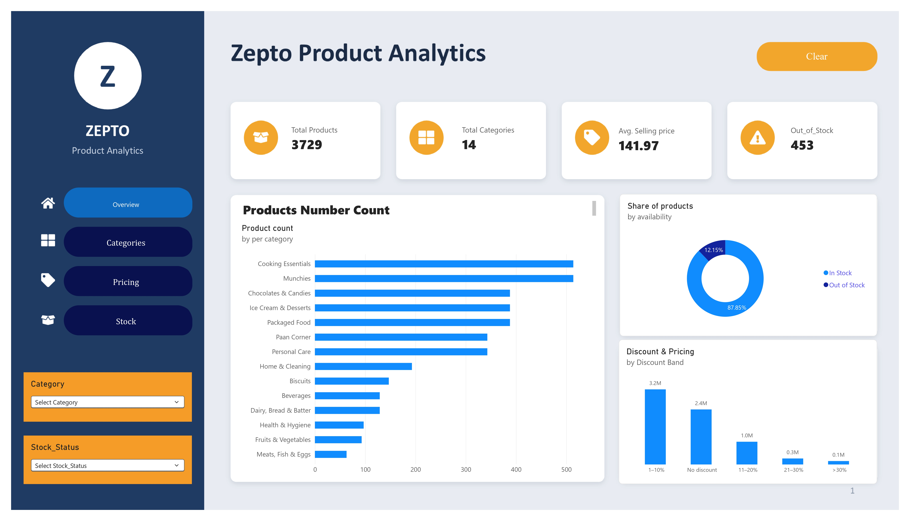
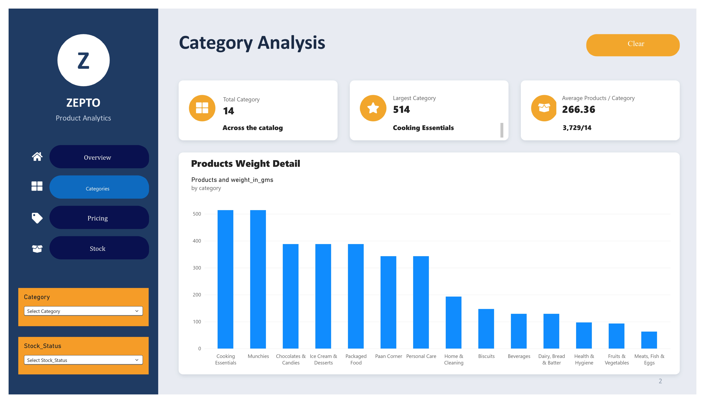
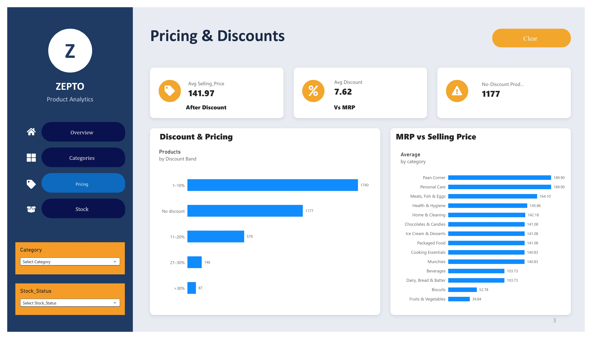
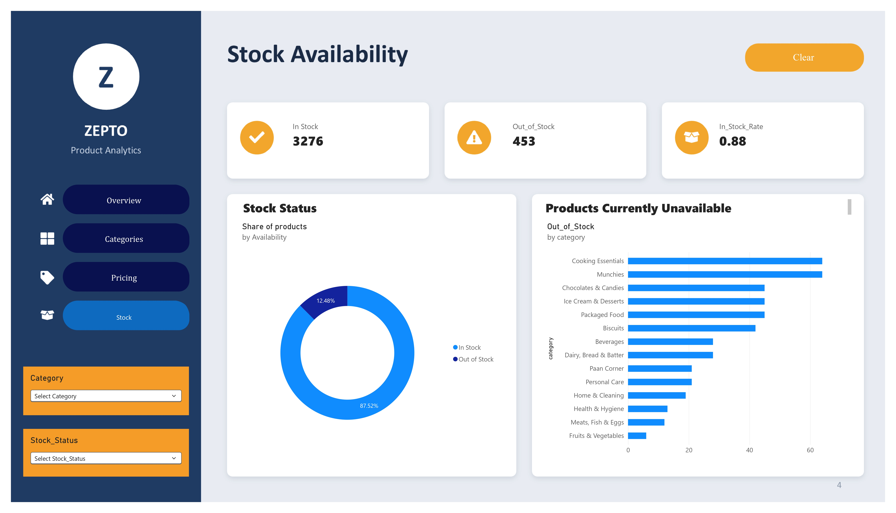

# Zepto E-commerce Product Analytics

An end-to-end analysis of a Zepto product catalogue (3,732 raw listings). The data is cleaned and explored in Python, queried in MySQL, and presented in a four-page Power BI report covering categories, pricing, discounts and stock availability.

## Objective

Understand how the catalogue is structured and answer a few practical questions:

- Which categories carry the most products, and which ones are discounted the most?
- How are products spread across price and discount bands?
- Where is stock availability weakest?
- Are discounted products stocked any differently from non-discounted ones?

## Tools

| Stage | Tool |
|---|---|
| Cleaning and EDA | Python (pandas, NumPy, Matplotlib), Jupyter |
| Querying | MySQL, MySQL Workbench |
| Dashboard | Power BI Desktop (DAX measures) |

## Repository structure

```
Zepto-Ecommerce-Analytics/
├── data/
│   ├── zepto_v2.csv            raw data
│   └── zepto_cleaned.csv       cleaned data used for SQL and Power BI
├── notebooks/
│   └── 01_zepto_data_cleaning_eda.ipynb
├── sql/
│   └── zepto_analytics.sql     table setup and 12 analysis queries
├── dashboard/
│   └── zepto_dashboard.pbix
├── images/                     dashboard screenshots used in this README
├── .gitignore
└── README.md
```

## Dataset

`zepto_v2.csv` has 3,732 rows and 9 columns. After cleaning, `zepto_cleaned.csv` has 3,729 rows and 14 columns.

| Column | Description |
|---|---|
| product_id | Row identifier added during cleaning |
| category | Product category (14 categories) |
| name | Product name |
| mrp | Maximum retail price, in rupees |
| discount_percent | Discount as listed in the source (whole number) |
| available_quantity | Units available |
| discounted_selling_price | Selling price after discount, in rupees |
| weight_in_gms | Pack weight in grams (4 values missing) |
| out_of_stock | 1 if out of stock, otherwise 0 |
| quantity | Pack size / quantity per listing |
| discount_amount | mrp minus discounted_selling_price (added) |
| calculated_discount_percent | Discount recomputed from the two prices (added) |
| stock_status | "In Stock" or "Out of Stock" (added) |
| discount_difference | calculated_discount_percent minus discount_percent (added) |

## Data cleaning

Done in `notebooks/01_zepto_data_cleaning_eda.ipynb`.

- Prices in the raw file are stored in paise. `mrp` and `discounted_selling_price` were divided by 100 to get rupees.
- One product (a liquid shoe polish) had an MRP and selling price of 0. It could not be recovered, so the row was dropped.
- Exact duplicate rows were checked for and removed.
- Four products had a weight of 0 g. These were set to missing rather than dropped.
- Column names were converted to snake_case so the file loads cleanly into MySQL and Power BI.
- The listed `discount_percent` matches the floor of the recomputed discount, which suggests the source truncates rather than rounds. The original column was kept as is, and the difference is stored in `discount_difference`.
- The same product name can appear in more than one category, so counts in this project are product listings, not unique products.

## SQL analysis

`sql/zepto_analytics.sql` creates the `zepto_cleaned` table and runs 12 queries covering catalogue share by category, average discount, out-of-stock rate, price bands, discount bands, price per gram, and stock levels for discounted versus non-discounted items.

To reproduce:

1. Create a database named `zepto_analytics` in MySQL.
2. Run the table definition at the top of the script.
3. Load `data/zepto_cleaned.csv` into `zepto_cleaned` (Workbench Table Data Import Wizard, or `LOAD DATA`).
4. Check that `SELECT COUNT(*) FROM zepto_cleaned;` returns 3729, then run the queries.

## Selected findings

- The catalogue has 3,729 listings across 14 categories, with an average listed discount of 7.62%.
- Cooking Essentials and Munchies are the largest categories, each about 13.8% of listings.
- Fruits & Vegetables has the highest average discount at 15.46%.
- 12.1% of listings are out of stock overall. Biscuits has the highest rate at 28.57%.
- Most listings (2,147) fall in the Rs 50 to 199 price band.
- Out-of-stock share is 10.9% for discounted items and 15.0% for items with no discount.
- The most expensive listing is Borges Extra Light Olive Oil at Rs 2,600 MRP.

## Power BI report

`dashboard/zepto_dashboard.pbix` has four pages: Overview, Categories, Pricing and Stock. It is built on `zepto_cleaned.csv` and uses category and stock-status slicers, KPI cards, and bar, column and donut charts, with DAX measures for the summary figures.

To open it, use Power BI Desktop. If the data source path breaks, go to Transform data > Data source settings and point it at `data/zepto_cleaned.csv`.

### Overview


### Categories


### Pricing


### Stock


## How to run the notebook

```bash
git clone https://github.com/itskrishnaawasthi-ui/Zepto-Ecommerce-Analytics.git
cd Zepto-Ecommerce-Analytics
pip install pandas numpy matplotlib jupyter mysql-connector-python
jupyter notebook notebooks/01_zepto_data_cleaning_eda.ipynb
```

The raw file contains non-UTF-8 characters, so it is read with `encoding="cp1252"`. The final cell loads the cleaned data into MySQL and asks for your local MySQL password when run.

## Limitations

- The dataset is a single snapshot, so no trends over time can be drawn.
- There are no sales or order figures. Availability and discount patterns describe the catalogue, not demand.
- Whether the same product name in different categories is a data issue or an intentional multi-listing could not be confirmed from the data.

## Author

Krishna Awasthi

LinkedIn: <https://www.linkedin.com/in/krishna-awasthi-071a17389/>